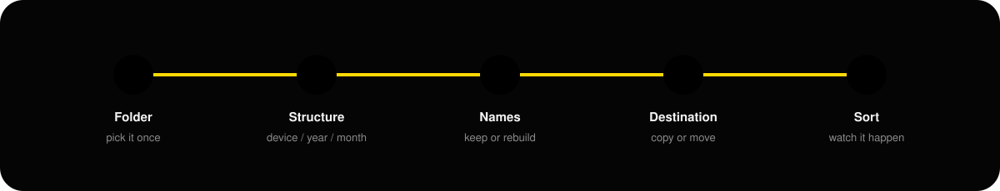

<p align="center">
  <a href="https://sortcdav.netlify.app"></a>
</p>

<h1 align="center">SORT</h1>

<p align="center">
  <b>Your camera roll, in folders that make sense.</b><br>
  SORT reads which camera shot each photo, when, and where, then files everything exactly the way you asked.<br>
  Free for macOS and Windows. No account. Your photos never leave your computer.
</p>

<p align="center">
  <a href="https://sortcdav.netlify.app/#download"><b>Download SORT</b></a> &nbsp;·&nbsp;
  <a href="https://sortcdav.netlify.app">Website</a> &nbsp;·&nbsp;
  <a href="https://sortcdav.netlify.app/#report">Report a bug</a>
</p>

---

## Before and after

Thousands of files in one folder, named by whatever the camera felt like. SORT opens each file, reads the camera model, the moment it was taken and the GPS position, and builds the folders for you.

<p align="center"></p>

## Five steps, and the pile is gone

<p align="center"></p>

1. **Folder**: pick the folder once. SORT reads every file's metadata on your computer, and a bloom of your own photos shows the progress.
2. **Structure**: choose the shape, for example ★ **Device / Year / Month**, or build your own from device, year, month, day, city, country and type.
3. **Names**: keep the camera's file names, or rebuild them from the date, the device, the city and a counter.
4. **Destination**: **Copy** leaves the originals where they are. **Move** frees the space, and on the same drive it finishes in seconds. **Find duplicates** looks for the same photo kept twice. Not sure? Do a dry run first: you see every folder and nothing is written.
5. **Sort**: watch each photo fly into its folder, and see the result when it lands.

## What it saves you

<p align="center"></p>

<p align="center"></p>

| | By hand | With SORT |
|---|---|---|
| Four thousand photos | 3 to 5 hours of dragging | About 4 minutes, most of it the disk copying |
| Dates | Read off each file, or guessed from the name | Taken from the file itself |
| Places | GPS stays locked inside the photo | Coordinates become city names, offline |
| Mistakes | One slip and a folder lands inside another | A dry run shows the whole tree first |
| Next month | Start again | Same settings, one click |

## Find duplicate photos

<p align="center"></p>

The same photo saved twice, even the smaller copy WhatsApp sent back, is found on your computer. No AI and no internet: SORT compares the pictures themselves.

- **Exact copies**: the same file under another name, such as `IMG_0002 (1).jpg`.
- **Resized copies**: WhatsApp, exports and re-saves. SORT shrinks each photo to a tiny 64-bit fingerprint, and pictures that look the same have almost the same one.
- **The original stays**: the one with the camera's data, the most pixels and the biggest file. Click any photo to keep that one instead.
- **You choose what happens to the copies**: a `Duplicates` folder next to your photos, or the Trash in the app. Nothing is ever deleted for good.
- Photos only: JPG, PNG, HEIC, WebP and raw files. Videos, music and documents are left alone.

## Download

Get it from **[sortcdav.netlify.app](https://sortcdav.netlify.app/#download)**. The page picks the right file for your computer.

| Computer | File |
|---|---|
| Mac with Apple chip (M1 and newer) | `.dmg` (Apple chip) |
| Mac with Intel | `.dmg` (Intel) |
| Windows 10 / 11 | Installer, or a portable app that needs no install |

### Fastest: one line in the Terminal

**macOS**: open Terminal and paste. It downloads SORT, puts it in Applications and opens it, with no "unidentified developer" warning.

```bash
curl -fsSL https://sortcdav.netlify.app/install.sh | bash
```

**Windows**: open PowerShell and paste. It downloads SORT and installs it for your user, no administrator needed.

```powershell
irm https://sortcdav.netlify.app/install.ps1 | iex
```

Both check the file's SHA-256 fingerprint against the one the site publishes before installing anything.

<details>
<summary>Installed from the .dmg and macOS says SORT cannot be opened?</summary>

SORT has no paid Apple certificate, so macOS blocks it the first time. Run this once in Terminal, then open SORT normally:

```bash
xattr -dr com.apple.quarantine /Applications/SORT.app
```
</details>

<details>
<summary>Windows says the publisher is unknown?</summary>

Choose **More info**, then **Run anyway**. Windows asks only the first time.
</details>

## Features

- **Camera, date and place come from the file itself**: EXIF, HEIC and QuickTime metadata, not the file name. iPhone, Canon, DJI, GoPro and others write their model into the file, so device folders need no typing.
- **Places without the internet**: GPS coordinates are matched to a city from a list built into SORT. No lookup leaves your machine.
- **Real photos while it works**: the scan and the sort show thumbnails of your own pictures and frames from your clips.
- **Raw files too**: DNG (iPhone ProRAW included), CR2, NEF, ARW, ORF, RW2, PEF, SRW and RAF keep their camera.
- **Finds duplicate photos**: exact copies and resized ones such as WhatsApp sends; the original stays, the copies go to a Duplicates folder or the Trash.
- **Live Photos stay in one piece**: the picture and its short video land in the same folder.
- **Screenshots stop crowding the camera roll**: they get a folder of their own.
- **Built for big libraries**: 100 GB uses about as much memory as 100 MB, and scanning reads only each file's header.
- **Updates itself**: Settings → Check for updates, or let SORT check on its own.
- **Light and dark**, in English, Română, Deutsch, Français, Italiano, 한국어 and 中文.

### Formats

Photos: JPG, HEIC, HEIF, PNG, WebP, AVIF, TIFF, GIF, BMP, JXL, and raw DNG, CR2, CR3, NEF, ARW, ORF, RW2, PEF, SRW, RAF and more.
Videos: MOV, MP4, M4V, AVI, MKV, 3GP, WebM, MTS, M2TS, MPG, WMV, INSV and more.

## Privacy

Your photos and videos never leave your device. No account, no cookies, no analytics, no ads. SORT only talks to its own website, to see whether a newer version exists. Read the [Privacy Policy](https://sortcdav.netlify.app/privacy.html).

## Questions

**Is it really free?** Yes. No trial, no limits, no paid version, no advertising.

**Can it lose a photo?** Copy never touches the originals. Move deletes an original only after its copy has been written and its size checked. Keep a backup of anything you cannot replace.

**What happens to a photo with no date or no GPS?** It simply loses that folder level instead of landing in a junk folder.

**Found a problem?** [Report it here](https://sortcdav.netlify.app/#report). Every report is read, and you get an answer when the fix is out.

---

<p align="center">
  <a href="https://sortcdav.netlify.app/privacy.html">Privacy Policy</a> ·
  <a href="https://sortcdav.netlify.app/terms.html">Terms of Service</a> ·
  <a href="https://sortcdav.netlify.app/legal.html">Legal</a>
  <br><br>
  Copyright © 2026 CDAV.IO. All rights reserved.
</p>
