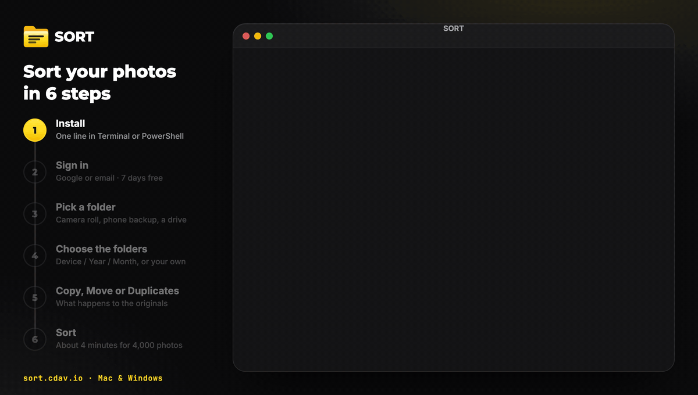
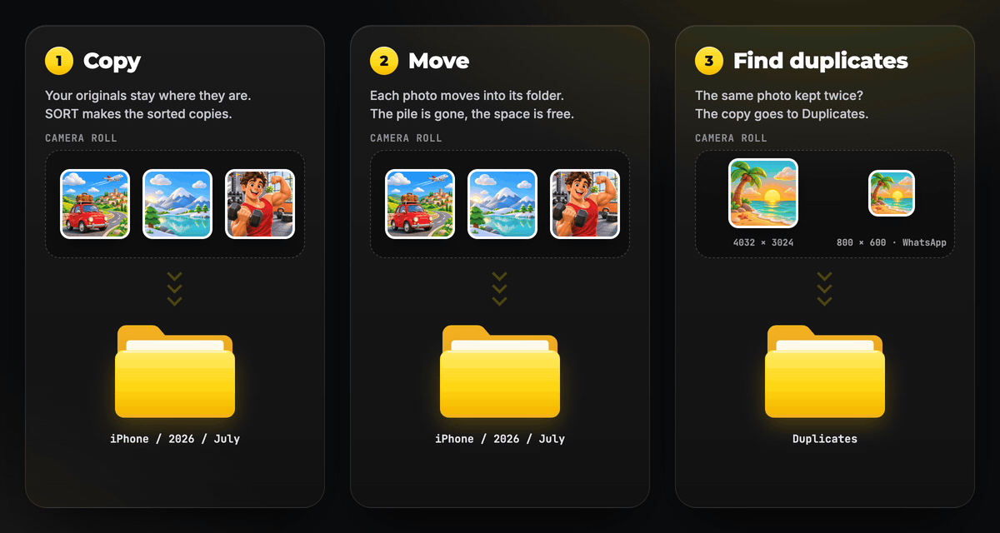
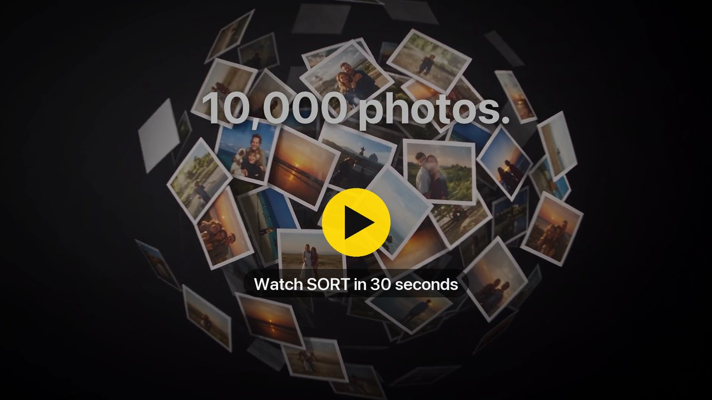
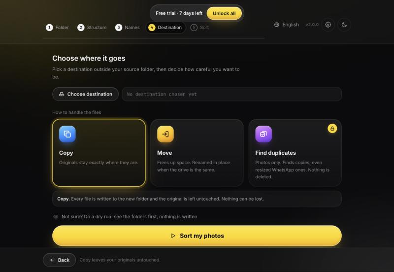

<p align="center">
  <a href="https://sort.cdav.io"></a>
</p>

<h1 align="center">SORT: the photo organizer for Mac and Windows</h1>

<p align="center">
  <b>4,000 photos. 4 hours by hand. 4 minutes with SORT.</b><br>
  Sort photos and videos into folders by <b>camera</b>, <b>date</b> and <b>place</b>, rename them, and find <b>duplicate photos</b>.<br>
  Everything happens on your computer. Your photos never leave it.
</p>

<p align="center">
  <a href="https://sort.cdav.io/#download"></a>
  <a href="https://sort.cdav.io/#download"></a>
  <a href="https://sort.cdav.io/pricing"></a>
</p>

<p align="center">
  <a href="https://sort.cdav.io">Website</a> &nbsp;·&nbsp;
  <a href="#how-to-sort-your-photos-in-6-steps">Tutorial</a> &nbsp;·&nbsp;
  <a href="#copy-move-or-find-duplicates">Copy, Move, Duplicates</a> &nbsp;·&nbsp;
  <a href="https://sort.cdav.io/pricing">Pricing</a> &nbsp;·&nbsp;
  <a href="guides/">Guides</a> &nbsp;·&nbsp;
  <a href="FAQ.md">FAQ</a>
</p>

> **Your camera roll is thousands of files called `IMG_4821.HEIC`.** Sorting them by hand costs an evening, every few months. SORT reads which camera took each photo, when and where, then files everything into clear folders such as `iPhone 15 Pro / 2026 / July`. Next month it is one click.

---

## How to sort your photos in 6 steps

<p align="center"></p>

1. **Install.** Paste one line in Terminal (Mac) or PowerShell (Windows), or download the `.dmg` / installer from [sort.cdav.io](https://sort.cdav.io/#download). [Step-by-step install guide](guides/install-sort-on-mac-and-windows.md).
2. **Sign in.** Use Google or email. Your 7 free days start, with no card needed.
3. **Pick a folder.** Choose your camera roll, a phone backup, an external drive or any folder. SORT reads each file's camera, date and GPS on your computer. Nothing is uploaded.
4. **Choose the folders.** ★ **Device / Year / Month** is the favourite. There are also Year / Month, Year / Month / Day, Location / Year / Month / Day, Type / Year / Month, or Custom: build your own from device, year, month, day, city, country and file type. Rename the files too if you like, for example `iPhone_2026-07-14_0001.heic`.
5. **Copy, Move or Find duplicates.** Choose what happens to your originals ([explained below](#copy-move-or-find-duplicates)). Not sure? Turn on **Dry run**: you see every folder and nothing is written.
6. **Sort.** Press **Sort my photos**. Each photo flies into its folder, and you see the result when it lands. About 4 minutes for 4,000 photos.

## Copy, Move or Find duplicates

<p align="center"></p>

| | What happens | Choose it when |
|---|---|---|
| **1 · Copy** | Your originals stay where they are. SORT writes sorted copies into new folders. | You want the safest option, or you sort to another drive. |
| **2 · Move** | Each photo moves into its folder. The old pile is gone and no space is used twice. On the same drive it finishes in seconds. | Your disk is full, or you already have a backup. |
| **3 · Find duplicates** | SORT finds the same photo kept twice, even a smaller copy WhatsApp sent back. The original stays; the copies go to a `Duplicates` folder. | Your library grew from backups, chats and exports. |

Move removes an original only after its copy has been written and its size checked. Nothing is ever deleted for good: copies go to a folder or to the Trash, and you decide. Read more in [Copy vs Move](guides/copy-vs-move.md) and [Find duplicate photos](guides/find-duplicate-photos.md).

## Watch SORT in 30 seconds

<p align="center">
  <a href="https://sort.cdav.io/media/sort-ad-long.mp4"></a>
</p>

## Before and after

Thousands of files in one folder, named by whatever the camera felt like. SORT opens each file and reads the camera model, the moment it was taken and the GPS position from the EXIF, HEIC and QuickTime metadata. Then it builds the folders for you.

<p align="center"></p>

## The app

<p align="center"></p>

## What it saves you

<p align="center"></p>

<p align="center"></p>

| | By hand | With SORT |
|---|---|---|
| 4,000 photos | 3 to 5 hours of dragging | About 4 minutes, mostly the disk copying |
| Dates | Read off each file, or guessed from the name | Taken from the photo's own metadata |
| Places | GPS stays hidden inside the photo | Coordinates become city and country names, offline |
| Duplicates | Compared by eye, one by one | Found by comparing the pictures themselves |
| Mistakes | One slip and a folder lands inside another | A dry run shows the whole tree first |
| Next month | Start again | Same settings, one click |

## Who uses SORT

- **Families**: years of kids, holidays and birthdays from three phones in one tidy archive.
- **Travellers**: every trip sorted by country, city and day, straight from the GPS in each photo.
- **Pet owners**: thousands of photos of the dog or the cat, finally in folders by year and month.
- **Gym and fitness**: progress photos in order by date, so the change is easy to see.
- **Car lovers and photographers**: Canon, Sony, Nikon, DJI drone and GoPro files kept apart by camera, raw files included.
- **Anyone switching phones**: an old iPhone or Android backup sorted before it goes on a new computer or drive.

## Find duplicate photos

<p align="center">
  <picture>
    <source media="(prefers-color-scheme: light)" srcset="images/duplicates-light.svg">
    
  </picture>
</p>

- **Exact copies**: the same file under another name, such as `IMG_0002 (1).jpg`.
- **Resized copies**: from WhatsApp, exports and re-saves. SORT turns each photo into a tiny 64-bit fingerprint. Pictures that look the same get almost the same fingerprint.
- **The best one stays**: the one with the camera's data, the most pixels and the biggest file. Click any photo to keep that one instead.
- **No AI and no internet**: the pictures are compared on your computer.
- Photos only: JPG, PNG, HEIC, WebP and raw files. Videos, music and documents are left alone.

## Features

- **Sort photos by date, camera and location**: taken from the file itself (EXIF, HEIC, QuickTime), not from the file name.
- **Organize iPhone and Android photos**: iPhone, Samsung, Pixel, Canon, Sony, Nikon, DJI and GoPro write their model into each file, so device folders need no typing.
- **Rename photos by date**: rebuild file names from the date, device, city and a counter, or keep the camera's names.
- **Places without the internet**: GPS coordinates are matched to a city from a list built into SORT.
- **Raw files too**: DNG (iPhone ProRAW included), CR2, CR3, NEF, ARW, ORF, RW2, PEF, SRW and RAF keep their camera.
- **Live Photos stay in one piece**: the picture and its short video land in the same folder.
- **Screenshots get their own folder**, out of the way of real photos.
- **Built for big libraries**: 100 GB uses about as much memory as 100 MB. Scanning reads only each file's header.
- **Your own photos on screen**: the scan and the sort show thumbnails of your pictures and frames from your clips.
- **Updates itself**, in light and dark, in English, Română, Deutsch, Français, Italiano, 한국어 and 中文.

### Supported formats

**Photos:** JPG, JPEG, HEIC, HEIF, PNG, WebP, AVIF, TIFF, GIF, BMP, JXL, and raw DNG, CR2, CR3, NEF, ARW, ORF, RW2, PEF, SRW, RAF and more.<br>
**Videos:** MOV, MP4, M4V, AVI, MKV, 3GP, WebM, MTS, M2TS, MPG, WMV, INSV and more.

## Download

Get SORT from **[sort.cdav.io](https://sort.cdav.io/#download)**. The page picks the right file for your computer.

| Computer | File |
|---|---|
| Mac with Apple chip (M1, M2, M3, M4 and newer) | `.dmg` (Apple chip) |
| Mac with Intel | `.dmg` (Intel) |
| Windows 10 / 11 | Installer, or a portable app that needs no install |

**Fastest on Mac**: open Terminal and paste. SORT goes into Applications and opens, with no "unidentified developer" warning.

```bash
curl -fsSL https://sort.cdav.io/install.sh | bash
```

**Fastest on Windows**: open PowerShell and paste. No administrator needed.

```powershell
irm https://sort.cdav.io/install.ps1 | iex
```

Both check the file's SHA-256 fingerprint before installing anything. Full walkthrough with every warning explained: [Install SORT on Mac and Windows](guides/install-sort-on-mac-and-windows.md).

## One price. A whole year.

<p align="center"><b>45 € per year</b>, VAT included. Not per month.</p>

| | |
|---|---|
| **Try it free** | 7 days of Copy and Move, no card needed |
| **One payment** | Copy, Move and Find duplicates for 365 days, on every Mac and PC you own |
| **No subscription trap** | Nothing renews by itself |
| **Changed your mind?** | Refund within 14 days, from your account |
| **For comparison** | A typical AI subscription is 20 $ a month, 240 $ a year |

Pay with card, Apple Pay or Google Pay through Stripe. New members often get an introductory offer on [sort.cdav.io/pricing](https://sort.cdav.io/pricing).

## Privacy

Your photos and videos never leave your device: SORT reads them on your computer and uploads nothing. Your account (Google or email) holds only your plan and your invoices. Payments go through Stripe, and SORT never sees your card. No ads, ever. Read the [Privacy Policy](https://sort.cdav.io/privacy).

## Guides

- [How to organize photos on a Mac](guides/organize-photos-on-mac.md)
- [How to organize photos on Windows 10 and 11](guides/organize-photos-on-windows.md)
- [How to sort photos by date, camera and location](guides/sort-photos-by-date-camera-location.md)
- [How to find and remove duplicate photos](guides/find-duplicate-photos.md)
- [Copy vs Move: which one to choose](guides/copy-vs-move.md)
- [Install SORT on Mac and Windows](guides/install-sort-on-mac-and-windows.md)
- [Frequently asked questions](FAQ.md)

## Earn with SORT

Recommend SORT and earn 15% to 20% of every sale you bring: [Affiliate Program](https://sort.cdav.io/affiliate).

## Found a problem?

[Report it here](https://sort.cdav.io/#report). Every report is read, and you get an answer when the fix is out.

---

<p align="center">
  <a href="https://sort.cdav.io">sort.cdav.io</a> ·
  <a href="https://sort.cdav.io/privacy">Privacy Policy</a> ·
  <a href="https://sort.cdav.io/terms">Terms of Service</a> ·
  <a href="https://sort.cdav.io/legal">Legal</a> ·
  <a href="mailto:hello@cdav.io">hello@cdav.io</a>
  <br><br>
  <sub>SORT is a photo organizer, photo sorter and duplicate photo finder for macOS and Windows. Organize photos by date, camera and location, rename photos by date, and clean up iPhone, Android and camera libraries offline.</sub>
  <br><br>
  Copyright © 2026 CDAV.IO. All rights reserved.
</p>
