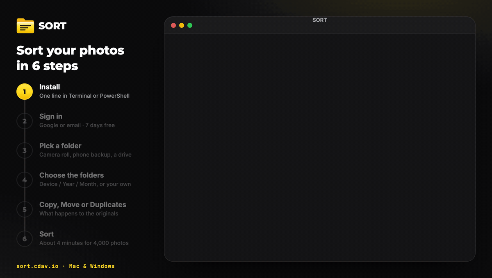

# SORT guides: organize photos on Mac and Windows

Short, practical guides for cleaning up a photo library with [SORT](https://sort.cdav.io), the offline photo organizer for macOS and Windows.

| Guide | What you learn |
|---|---|
| [How to organize photos on a Mac](organize-photos-on-mac.md) | Sort an iPhone camera roll, a Photos export or a drive into folders on macOS |
| [How to organize photos on Windows](organize-photos-on-windows.md) | Clean up the Pictures folder, a phone backup or an external drive on Windows 10 and 11 |
| [Sort photos by date, camera and location](sort-photos-by-date-camera-location.md) | How SORT reads EXIF metadata and builds folders like `iPhone 15 Pro / 2026 / July` |
| [Find and remove duplicate photos](find-duplicate-photos.md) | Find exact and resized copies, such as WhatsApp duplicates, without AI and without the internet |
| [Copy vs Move](copy-vs-move.md) | Which option keeps your originals, which one frees space, and when to use a dry run |
| [Install SORT on Mac and Windows](install-sort-on-mac-and-windows.md) | The one-line install, the `.dmg`, the Windows installer, and every warning explained |

[Back to SORT](../README.md) · [Download SORT, 7 days free](https://sort.cdav.io/#download)
