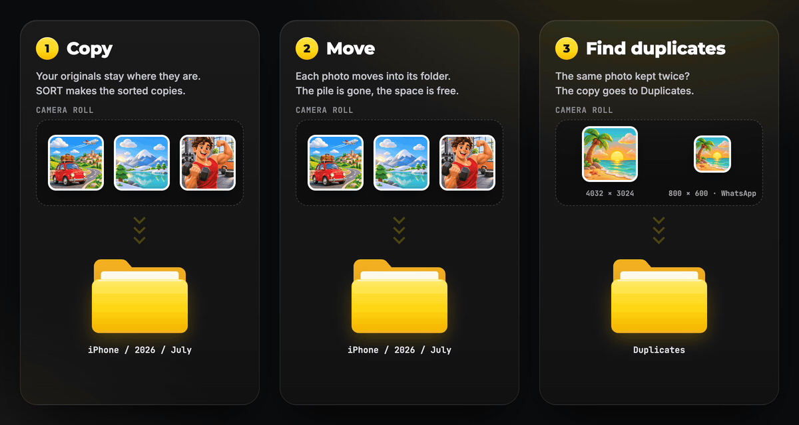

# Copy vs Move vs Find duplicates: which one to choose

When SORT organizes your photos, you decide what happens to the originals. Here is the difference, in one picture and one table.

| | Copy | Move | Find duplicates |
|---|---|---|---|
| Originals | Stay exactly where they are | Go into the new folders | The best one stays |
| Disk space | Uses space for the copies | Frees space, nothing doubled | Frees space taken by copies |
| Speed | The disk copies every file | Seconds on the same drive | A quick scan, then you review |
| Safest for | First runs, sorting to another drive | Full disks, when you have a backup | Libraries grown from backups and chats |

## Copy

SORT writes sorted copies into new folders and never touches the originals. Choose it the first time, or when you sort from a phone backup or USB drive onto your computer.

## Move

Each photo goes straight into its folder. SORT removes an original only after its new copy has been written and its size checked. On the same drive, files are only re-filed, so even huge libraries finish in seconds.

## Find duplicates

The same photo kept twice, even a smaller copy WhatsApp sent back, is found by comparing the pictures themselves. The copies go to a `Duplicates` folder or the Trash, never deleted for good. See [Find duplicate photos](find-duplicate-photos.md).

## Not sure? Use a dry run

Turn on **Dry run** and SORT shows every folder it would create, with nothing written. Happy with it? Run it for real.

Keep a backup of photos and videos you cannot replace.

---

[All guides](README.md) · [Back to SORT](../README.md) · [Download SORT](https://sort.cdav.io/#download)
