# How to find and remove duplicate photos (Mac and Windows)

Backups, WhatsApp, AirDrop and exports leave the same photo on your disk two, three, five times. SORT's duplicate photo finder catches exact copies **and** resized ones, keeps the best version, and sets the rest aside. No AI, no internet, nothing deleted for good.

  <picture>
    <source media="(prefers-color-scheme: light)" srcset="../images/duplicates-light.svg">
    
  </picture>

## How it works

1. **Pick a folder** in SORT and choose **Find duplicates**.
2. SORT turns every photo into a tiny 64-bit fingerprint of what it looks like. Pictures that look the same get almost the same fingerprint, even after resizing or re-compression.
3. Matches are shown in groups. **The original stays**: the one with the camera's data, the most pixels and the biggest file. Click any photo to keep that one instead.
4. **You choose** where the copies go: a `Duplicates` folder next to your photos, or the Trash. Check each group first; nothing is removed until you confirm.

## What it finds

| Kind | Example |
|---|---|
| Exact copies | `IMG_0002.jpg` and `IMG_0002 (1).jpg` |
| Resized copies | The 800 × 600 photo WhatsApp sent back next to the 4032 × 3024 original |
| Re-saved exports | The same picture exported again from an editor |

Photos only: JPG, PNG, HEIC, WebP and raw files. Videos, music and documents are left alone.

## Why not an online duplicate cleaner?

Online cleaners need your photos on their servers. SORT compares the pictures on your own computer. Read the [Privacy Policy](https://sort.cdav.io/privacy).

Find duplicates is part of the yearly plan (45 € per year, VAT included). Copy and Move are free for the first 7 days. [See pricing](https://sort.cdav.io/pricing).

---

[All guides](README.md) · [Back to SORT](../README.md) · [Download SORT](https://sort.cdav.io/#download)
