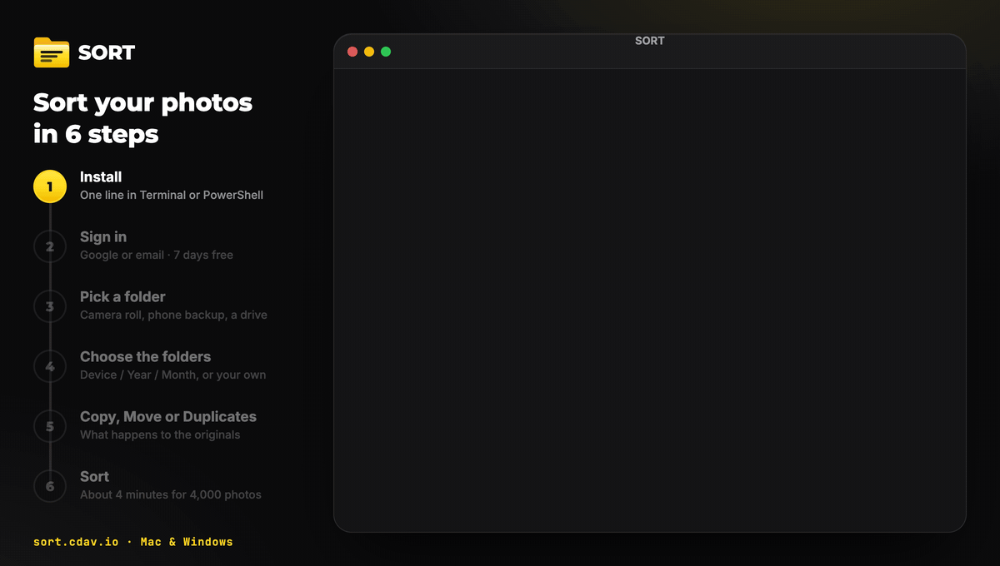

# Install SORT on Mac and Windows

SORT installs in one line, or from a normal download. Every warning you might see is explained below.

<p align="center"></p>

## Mac: one line in Terminal (recommended)

1. Press **⌘ Space**, type **Terminal** and press Enter.
2. Paste this line and press Enter:
   ```bash
   curl -fsSL https://sort.cdav.io/install.sh | bash
   ```
3. SORT downloads, its SHA-256 fingerprint is checked against the one the site publishes, it goes into **Applications**, and it opens. No "unidentified developer" warning.

## Mac: the .dmg

1. Download the `.dmg` for your Mac from [sort.cdav.io](https://sort.cdav.io/#download): **Apple chip** (M1 and newer) or **Intel**.
2. Open it and drag SORT into Applications.
3. macOS says SORT cannot be opened? SORT has no paid Apple certificate, so macOS blocks it the first time. Run this once in Terminal, then open SORT normally:
   ```bash
   xattr -dr com.apple.quarantine /Applications/SORT.app
   ```

## Windows: one line in PowerShell (recommended)

1. Press **Start**, type **PowerShell** and open it.
2. Paste this line and press Enter:
   ```powershell
   irm https://sort.cdav.io/install.ps1 | iex
   ```
3. SORT downloads, the fingerprint is checked, and it installs for your user. No administrator needed.

## Windows: the installer or the portable app

Download from [sort.cdav.io](https://sort.cdav.io/#download). If Windows says the publisher is unknown, choose **More info**, then **Run anyway**. Windows asks only the first time.

## After installing

Open SORT and sign in with Google or email. Your **7 free days** of Copy and Move start right away, with no card needed. Then follow the [Mac guide](organize-photos-on-mac.md) or the [Windows guide](organize-photos-on-windows.md).

SORT updates itself: **Settings → Check for updates**, or let it check on its own.

---

[All guides](README.md) · [Back to SORT](../README.md)
