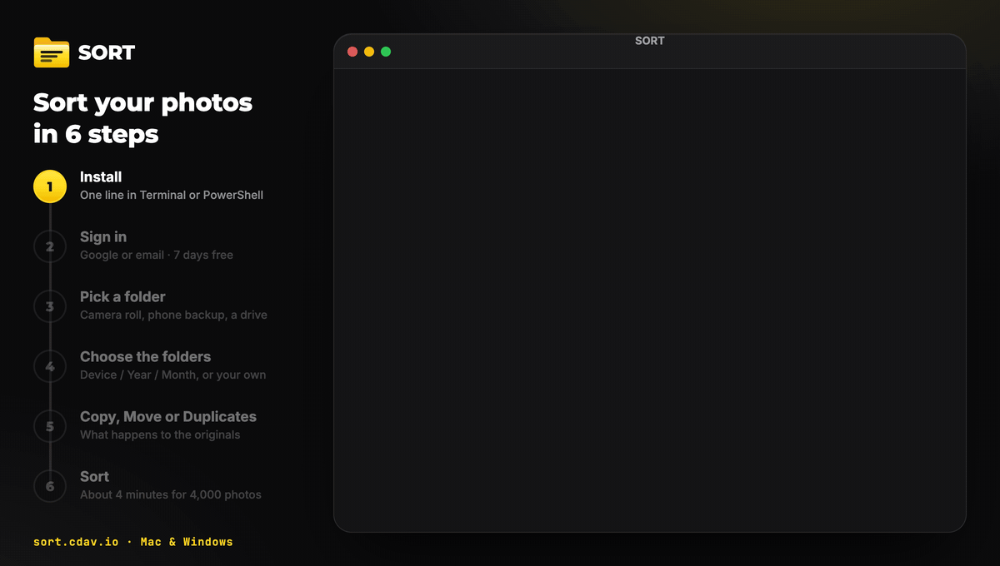

# How to organize photos on a Mac (fast, offline)

Thousands of `IMG_` files in Downloads, a Photos export or an old iPhone backup? Here is the quickest way to organize photos on a Mac into clear folders by camera, date and place, without uploading anything.

<p align="center"></p>

## What you need

- A Mac with an Apple chip (M1 and newer) or Intel, on a recent macOS.
- The folder with your photos: a camera roll copied from an iPhone, a **Photos → File → Export** folder, an SD card, or an external drive.
- [SORT](https://sort.cdav.io/#download). The first 7 days are free.

## Step by step

1. **Install SORT.** Open Terminal and paste:
   ```bash
   curl -fsSL https://sort.cdav.io/install.sh | bash
   ```
   SORT goes into Applications and opens. Prefer a normal download? Get the `.dmg` from [sort.cdav.io](https://sort.cdav.io/#download). See the [install guide](install-sort-on-mac-and-windows.md).
2. **Sign in** with Google or email. Your 7 free days start.
3. **Pick the folder.** SORT reads every photo's camera, date and GPS on your Mac. HEIC, ProRAW DNG and Live Photos are all understood.
4. **Choose the folders.** ★ **Device / Year / Month** gives you `iPhone 15 Pro / 2026 / July`. Want trips? Choose **Location / Year / Month / Day**.
5. **Choose Copy** to keep the originals, or **Move** to free the space. Turn on **Dry run** the first time to see the result without writing anything.
6. **Press Sort my photos.** About 4 minutes for 4,000 photos.

## Tips for Mac users

- **Photos app library:** export first (Photos → select all → File → Export → Export Unmodified Originals). SORT then sorts the exported files into real Finder folders you can open anywhere.
- **Live Photos** stay together: the picture and its short video land in the same folder.
- **Screenshots** get their own folder, so they stop burying real photos.
- **Same drive and Move** finishes in seconds, because files are only re-filed, not copied.

## Why not do it by hand in Finder?

Finder shows "Date Modified", which changes when files are copied. The real moment a photo was taken lives inside the file (EXIF). SORT reads it, so a photo from July 2019 lands in 2019 even if you copied it yesterday. Read more in [Sort photos by date, camera and location](sort-photos-by-date-camera-location.md).

---

[All guides](README.md) · [Back to SORT](../README.md) · [Download SORT for Mac](https://sort.cdav.io/#download)
