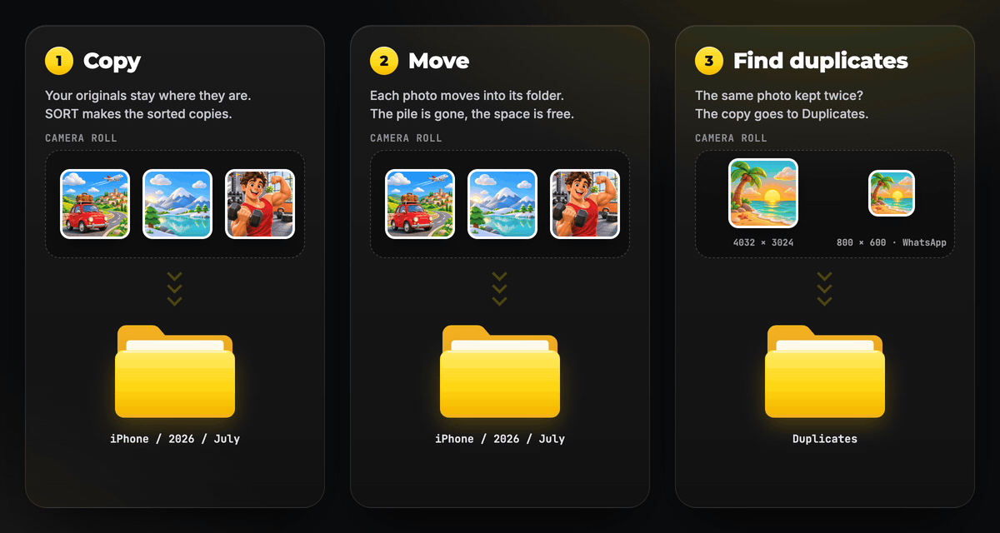

# How to organize photos on Windows 10 and 11

Your Pictures folder, a phone backup or an external drive full of `IMG_`, `DSC_` and `PXL_` files? This is how to organize photos on Windows into folders by camera, date and place in a few minutes, offline.

<p align="center"></p>

## What you need

- Windows 10 or Windows 11.
- The folder with your photos: `Pictures`, an Android or iPhone backup, an SD card or a USB drive.
- [SORT](https://sort.cdav.io/#download). The first 7 days are free.

## Step by step

1. **Install SORT.** Open PowerShell and paste:
   ```powershell
   irm https://sort.cdav.io/install.ps1 | iex
   ```
   It installs for your user, with no administrator needed. You can also download the installer or the portable app from [sort.cdav.io](https://sort.cdav.io/#download).
2. **Sign in** with Google or email.
3. **Pick the folder** with your photos. SORT reads the camera, date and GPS of each file on your PC.
4. **Choose the folders**, for example ★ **Device / Year / Month** (`Galaxy S24 / 2026 / July`) or **Year / Month / Day**.
5. **Copy, Move or Find duplicates.** Copy keeps the originals. Move frees disk space. Find duplicates sets aside the same photo kept twice. See [Copy vs Move](copy-vs-move.md).
6. **Press Sort my photos.** Done in minutes.

## "Windows protected your PC"?

SORT has no paid code-signing certificate yet, so SmartScreen may warn you the first time you run the downloaded installer. Choose **More info**, then **Run anyway**. The PowerShell install checks the file's SHA-256 fingerprint before it runs.

## Tips for Windows users

- **Phone photos from Android** (Samsung, Pixel, Xiaomi) carry the phone model and the date in each file, so device folders build themselves.
- **External drives:** pick Copy to sort from a USB drive onto your PC, and the drive stays untouched.
- **Raw files** from Canon, Nikon, Sony, Fujifilm, Olympus, Panasonic and Pentax keep their camera name.

---

[All guides](README.md) · [Back to SORT](../README.md) · [Download SORT for Windows](https://sort.cdav.io/#download)
