# How to sort photos by date, camera and location

Every photo carries hidden information: the camera or phone that took it, the exact moment and, often, where it was taken. SORT reads this metadata and turns it into folders, so you never sort by hand again.

## Where the information comes from

| Folder level | Read from | Example |
|---|---|---|
| **Device** | EXIF camera make and model, QuickTime metadata for videos | `iPhone 15 Pro`, `Canon EOS R6`, `DJI Mini 4 Pro` |
| **Year, month, day** | The moment the photo was taken (EXIF DateTimeOriginal), not the file's modified date | `2026 / July / 14` |
| **City and country** | GPS coordinates, matched offline to a list built into SORT | `Rome`, `Italy` |
| **Type** | The file format | `Photos`, `Videos` |

No internet lookup is made. A photo with no GPS or no date simply skips that level instead of landing in a junk folder.

## The folder layouts you can pick

- ★ **Device / Year / Month**: the best for most libraries.
- **Device / Year / Month / Day**
- **Year / Month** and **Year / Month / Day**
- **Month / Year**
- **Location / Year / Month / Day**: perfect for travel.
- **Location / Device / Year / Month**
- **Type / Year / Month**
- **Flat**: all files in one folder, only renamed.
- **Custom**: compose your own from device, brand, year, month, day, city, country and type.

## Rename photos by date

Keep the camera's names, or rename every file from its metadata:

| Pattern | Example |
|---|---|
| Keep original | `IMG_0001.HEIC` |
| Day_Month_Year | `14_07_2026.heic` |
| Date and time | `2026-07-14_14-22-05.heic` |
| Date + original | `20260714_IMG_0001.heic` |
| Device + date + counter | `iPhone_2026-07-14_0001.heic` |
| Custom | Build your own |

## Try it

[Download SORT](https://sort.cdav.io/#download), pick a folder, and turn on **Dry run** to see the whole folder tree before anything is written. Step-by-step: [Mac](organize-photos-on-mac.md) · [Windows](organize-photos-on-windows.md).

---

[All guides](README.md) · [Back to SORT](../README.md)
